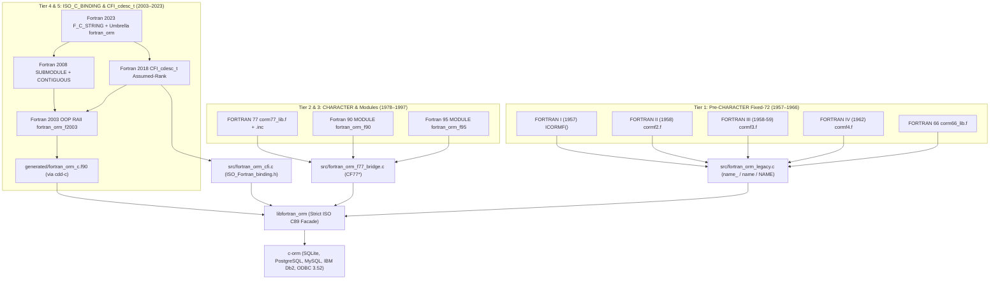

# fortran-orm

[](LICENSE-APACHE)
[](https://github.com/SamuelMarks/fortran-orm/actions/workflows/ci.yml)
[](include/fortran_orm_ffi.h)
[](docs/STANDARDS_MATRIX.md)
[](UNDERCOVERED.md)
[](UNDERCOVERED.md)

**`fortran-orm`** is a zero-compromise Fortran Object-Relational Mapping (ORM), SQL query builder, and scientific column-major array persistence library built over [`c-orm`](../c-orm) with `ISO_C_BINDING` modules generated reproducibly via [`cdd-c`](../cdd-c) (`cdd-c bind -l fortran`).

Uniquely, `fortran-orm` supports **all 12 historical and ISO Fortran standards spanning 66 years of scientific computing (1957–2023)**:

1. **FORTRAN (I)** (1957 — IBM 704)
2. **FORTRAN II** (1958 — `SUBROUTINE` / `CALL` / `COMMON`)
3. **FORTRAN III** (1958–59 — portable boolean status word masks)
4. **FORTRAN IV** (1962 — `LOGICAL`, `DOUBLE PRECISION`, `BLOCK DATA`)
5. **FORTRAN 66** (ANSI X3.9-1966)
6. **FORTRAN 77** (ANSI X3.9-1978 — `CHARACTER*(*)`, `PARAMETER`, `INCLUDE`)
7. **Fortran 90** (ISO/IEC 1539:1991 — `MODULE`, generic overloads, `ALLOCATABLE`)
8. **Fortran 95** (ISO/IEC 1539-1:1997 — `PURE`, `ELEMENTAL`, `FORALL`)
9. **Fortran 2003** (ISO/IEC 1539-1:2004 — `ISO_C_BINDING`, OOP classes, RAII `FINAL`)
10. **Fortran 2008** (ISO/IEC 1539-1:2010 — `SUBMODULE`, `CONTIGUOUS` zero-copy arrays)
11. **Fortran 2018** (ISO/IEC 1539-1:2018 — `CFI_cdesc_t` assumed-rank & strided slices)
12. **Fortran 2023** (ISO/IEC 1539-1:2023 — `F_C_STRING`, modern umbrella ORM)

---

## Architecture Overview



---

## Key Capabilities

- **6 Database Backends via `c-orm`**: SQLite (`:memory:` & file), PostgreSQL, MySQL/MariaDB, IBM Db2 CLI (`z/OS` & LUW), Generic ANSI/ISO ODBC 3.52, and in-memory mock driver.
- **Native Fortran Column-Major Scientific Persistence**: Zero-transpose batch insertion and SQL hydration of 1D contiguous vectors (`INT32`, `INT64`, `REAL64`) and 2D column-major matrices `A(ld_rows, n_cols)`, plus Fortran 2018/2023 `CFI_cdesc_t` strided array slices (`A(1:N:2, :)`).
- **Runtime `BIND(C)` Derived-Type CRUD**: Persist arbitrary Fortran `TYPE, BIND(C)` records with `insert`, dialect-aware `upsert`, `update`, `update_optimistic`, `find_i32`, `find_for_update_i32`, `exists_i32`, `delete_i32`, `find_all`, and foreign-key relation metadata.
- **5-Dialect Arena SQL AST & Schema-Less Result Sets**: Build injection-safe queries rendered for SQLite (`?`), PostgreSQL (`$1..$N`), MySQL, IBM Db2 (`FETCH FIRST`, `WITH UR`), or ODBC 3.52, and serialize dynamic result sets directly to JSON.
- **Enterprise & Scientific Extensions**: Connection pooling, deterministic horizontal shard routing, nested savepoints, `-- UP` / `-- DOWN` SQL migrations, exact 38-digit fixed-point `DECIMAL` arithmetic, mainframe `EBCDIC` (CCSID 037/500/1047/1140) & UTF-16 `GRAPHIC` transcoding, RFC 4122 UUID v4, and OAuth2 token persistence.
- **Strict Quality Guarantees**:
  - **100.0% test coverage** (functions, lines, and branches via `gcovr` + deterministic OOM fault injection).
  - **100.0% documentation coverage** across C89 (`Doxygen` `WARN_AS_ERROR=YES`) and Fortran (`scripts/check_fortran_docs.py`).
  - **Unified Error Enum**: Every C function returns `fortran_orm_error_t` (`FORTRAN_ORM_NO_DISCARD`) with zero `(void)` discards.

---

## Quick Build & Verification

```sh
# 1. Regenerate ISO_C_BINDING module via ../cdd-c (and verify zero drift)
./scripts/generate_bindings.sh
./scripts/generate_bindings.sh --check

# 2. Configure, build all 12 Fortran standard eras + C89 core, and run CTest
cmake -S . -B build -G Ninja -DCMAKE_EXPORT_COMPILE_COMMANDS=ON
cmake --build build --parallel
ctest --test-dir build --output-on-failure -j4

# 3. Verify 100% documentation, enum-return, and 12-era dialect gates
python3 scripts/generate_undercovered.py --doc
python3 scripts/check_enum_returns_clang.py
python3 scripts/check_fortran_era_compliance.py
```

---

## Runnable Examples Across All 12 Fortran Eras (`examples/`)

Every example builds cleanly under its era's strict compiler flags and runs as an automated `CTest` target:

| Standard Era | Runnable Example(s) | Domain & Features Showcased |
| :--- | :--- | :--- |
| **FORTRAN (I)** (1957) | [`fortran_i_1957_telemetry.f`](examples/fortran_i_1957_telemetry.f), [`fortran_i_1957_census_tabulator.f`](examples/fortran_i_1957_census_tabulator.f), [`fortran_i_1957_drum_inventory.f`](examples/fortran_i_1957_drum_inventory.f), [`fortran_i_1957_cosmic_ray_hodoscope.f`](examples/fortran_i_1957_cosmic_ray_hodoscope.f) | IBM 704 wind-tunnel Mach logger; municipal census tabulator; Type 733 drum EOQ stock ledger; IGY cosmic-ray Geiger hodoscope (`EQUIVALENCE`, `NAMF()`, computed `GO TO`, `ICORMF`) |
| **FORTRAN II** (1958) | [`fortran_ii_1958_ballistics.f`](examples/fortran_ii_1958_ballistics.f), [`fortran_ii_1958_hydro_reservoir.f`](examples/fortran_ii_1958_hydro_reservoir.f), [`fortran_ii_1958_naca_airfoil_polar.f`](examples/fortran_ii_1958_naca_airfoil_polar.f), [`fortran_ii_1958_lunar_ranging_doppler.f`](examples/fortran_ii_1958_lunar_ranging_doppler.f) | Ballistic range; hydro dam ledger; NACA 2412 airfoil polar (`F2VECD`/`F2MATI`/`F2SCLD`); VHF lunar radar Doppler (`F2OPA4`/`F2BNA4` packed `A4`, `F2TXBG`/`F2TXRB`) |
| **FORTRAN III** (1958–59) | [`fortran_iii_1958_reactor_scram.f`](examples/fortran_iii_1958_reactor_scram.f), [`fortran_iii_1958_radar_track.f`](examples/fortran_iii_1958_radar_track.f), [`fortran_iii_1958_relay_switching_matrix.f`](examples/fortran_iii_1958_relay_switching_matrix.f), [`fortran_iii_1958_magnet_coil_quench.f`](examples/fortran_iii_1958_magnet_coil_quench.f) | Reactor scram audit; SAGE radar gate; Crossbar No. 5 Erlang-B trunk switching (`F3GEX`, `IF3BIT`/`IF3ALL`); synchrotron magnet quench (`F3MATI`/`F3MATQ`, `/CORM3C/`) |
| **FORTRAN IV** (1962) | [`fortran_iv_1962_orbital_ephemeris.f`](examples/fortran_iv_1962_orbital_ephemeris.f), [`fortran_iv_1962_structural_truss.f`](examples/fortran_iv_1962_structural_truss.f), [`fortran_iv_1962_apollo_guidance_burn.f`](examples/fortran_iv_1962_apollo_guidance_burn.f), [`fortran_iv_1962_ac_power_loadflow.f`](examples/fortran_iv_1962_ac_power_loadflow.f) | Orbital ephemeris; pin-jointed truss; translunar Tsiolkovsky burn & `LOGICAL` ullage gate (`F4BINL`/`F4COLL`); AC grid DC load-flow (`F4MSCL`, `DF4NRM`, `LF4LIV`) |
| **FORTRAN 66** (1966) | [`fortran66_steam_tables.f`](examples/fortran66_steam_tables.f), [`fortran66_chemical_kinetics.f`](examples/fortran66_chemical_kinetics.f), [`fortran66_geodetic_triangulation.f`](examples/fortran66_geodetic_triangulation.f), [`fortran66_neutron_cross_section.f`](examples/fortran66_neutron_cross_section.f) | ASME steam tables; Arrhenius kinetics; Clarke-1866 geodetic triangulation (`C6VECD`, `C6QDBL`, `C6I2A1`); U-235 resonance cross-section (`C6KVIN`/`C6KVIT`) |
| **FORTRAN 77** (1978) | [`fortran77_ledger.f`](examples/fortran77_ledger.f), [`fortran77_ast_seismic.f`](examples/fortran77_ast_seismic.f), [`fortran77_ocean_hydrography.f`](examples/fortran77_ocean_hydrography.f), [`fortran77_atmospheric_radiosonde.f`](examples/fortran77_atmospheric_radiosonde.f), [`fortran77_distillation_tray_column.f`](examples/fortran77_distillation_tray_column.f) | Savepoint ledger; seismic AST; CTD cast; WMO radiosonde tropopause (`F7KVCR`/`F7VECD`); McCabe-Thiele distillation column (`F7CNT`, `F7EXST`, `F7DELI`, `F7ASAL`) |
| **Fortran 90** (1991) | [`fortran90_matrix_sim.f90`](examples/fortran90_matrix_sim.f90), [`fortran90_weather_stations.f90`](examples/fortran90_weather_stations.f90), [`fortran90_power_grid_dispatch.f90`](examples/fortran90_power_grid_dispatch.f90), [`fortran90_finite_element_beam.f90`](examples/fortran90_finite_element_beam.f90), [`fortran90_epidemic_sir_compartment.f90`](examples/fortran90_epidemic_sir_compartment.f90) | 2D heat mesh; weather network; economic dispatch; Hermite FEM cantilever (`corm_query_f90_t`, `corm_kv_f90_t`); RK4 SIR epidemic (`corm_ts_f90_t` time-series) |
| **Fortran 95** (1997) | [`fortran95_forall_cfd.f95`](examples/fortran95_forall_cfd.f95), [`fortran95_blackbody_planck.f95`](examples/fortran95_blackbody_planck.f95), [`fortran95_shallow_water_tsunami.f95`](examples/fortran95_shallow_water_tsunami.f95), [`fortran95_lattice_boltzmann_d2q9.f95`](examples/fortran95_lattice_boltzmann_d2q9.f95) | Supersonic nozzle CFD; Planck radiance; 2D tsunami bathymetry (`corm_grid2d_f95`, `corm_f95_insert_masked_matrix`); D2Q9 Lattice Boltzmann (`corm_f95_insert_affine_matrix`) |
| **Fortran 2003** (2004) | [`fortran2003_oop_models.f90`](examples/fortran2003_oop_models.f90), [`fortran2003_pool_and_ast.f90`](examples/fortran2003_pool_and_ast.f90), [`fortran2003_spectroscopy_crud.f90`](examples/fortran2003_spectroscopy_crud.f90), [`fortran2003_molecular_dynamics_lj.f90`](examples/fortran2003_molecular_dynamics_lj.f90), [`fortran2003_clinical_pharmacokinetics.f90`](examples/fortran2003_clinical_pharmacokinetics.f90) | RAII `BIND(C)` CRUD; pool & AST; HITRAN spectroscopy; Lennard-Jones MD (`ABSTRACT` `orm_model_base_t`, `orm_tx_guard_t`); clinical PK (`orm_decimal_t`, `orm_shard_router_t`, `orm_oauth2_store_t`) |
| **Fortran 2008** (2010) | [`fortran2008_contiguous_nbody.f90`](examples/fortran2008_contiguous_nbody.f90), [`fortran2008_kalman_navigation.f90`](examples/fortran2008_kalman_navigation.f90), [`fortran2008_multigrid_poisson_ckpt.f90`](examples/fortran2008_multigrid_poisson_ckpt.f90), [`fortran2008_seismic_tomography_sparse.f90`](examples/fortran2008_seismic_tomography_sparse.f90) | 4-body phase space; Kalman navigation; red-black SOR Poisson (`orm_checkpoint_f2008_t`, `corm_f2008_zscore_cols`); CSR seismic tomography (generic `CONTIGUOUS` vectors & submatrices) |
| **Fortran 2018** (2018) | [`fortran2018_cfi_strided_stencil.f90`](examples/fortran2018_cfi_strided_stencil.f90), [`fortran2018_acoustic_wavefield.f90`](examples/fortran2018_acoustic_wavefield.f90), [`fortran2018_3d_heat_tensor_cfi.f90`](examples/fortran2018_3d_heat_tensor_cfi.f90), [`fortran2018_mhd_alfven_strided.f90`](examples/fortran2018_mhd_alfven_strided.f90) | Strided stencil; 2D acoustic wavefield; 3D anisotropic heat brick (`SELECT RANK` `corm_f2018_save_tensor_f64`); MHD shear Alfven wave (`CFI_cdesc_t` strided probes) |
| **Fortran 2023** (2023) | [`fortran2023_scientific_orm.f90`](examples/fortran2023_scientific_orm.f90), [`fortran2023_mainframe_ebcdic_decimal.f90`](examples/fortran2023_mainframe_ebcdic_decimal.f90), [`fortran2023_isotope_decay_ledger.f90`](examples/fortran2023_isotope_decay_ledger.f90), [`fortran2023_exoplanet_transit_dataframe.f90`](examples/fortran2023_exoplanet_transit_dataframe.f90), [`fortran2023_carbon_flux_unit_of_work.f90`](examples/fortran2023_carbon_flux_unit_of_work.f90) | `F_C_STRING`, UUID v4; z/OS `EBCDIC`; isotope decay; exoplanet transit photometry (`orm_dataframe_f2023_t`); eddy-covariance carbon ledger (`orm_session_f2023_t`) |

---

## Documentation Index

- [`ARCHITECTURE.md`](ARCHITECTURE.md) — Multi-tier ABI design, symbol mangling, and `cdd-c` codegen pipeline
- [`USAGE.md`](USAGE.md) — End-to-end tutorials from 1957 FORTRAN I to Fortran 2023
- [`docs/STANDARDS_MATRIX.md`](docs/STANDARDS_MATRIX.md) — Exact feature & compiler flag matrix across all 12 standards
- [`docs/SCIENTIFIC_ARRAYS.md`](docs/SCIENTIFIC_ARRAYS.md) — Column-major `A(ld, ncols)` & `CFI_cdesc_t` slice persistence
- [`docs/API_REFERENCE.md`](docs/API_REFERENCE.md) — Complete C89 & Fortran module API reference
- [`docs/ERRORS.md`](docs/ERRORS.md) — Unified `fortran_orm_error_t` taxonomy (`0..38`)
- [`docs/MEMORY.md`](docs/MEMORY.md) — Ownership, RAII `FINAL` destructors, and OOM safety
- [`UNDERCOVERED.md`](UNDERCOVERED.md) — Live 100.0% test and documentation coverage ledger

## License

Dual-licensed under either [Apache License, Version 2.0](LICENSE-APACHE) or [MIT License](LICENSE-MIT) at your option.
